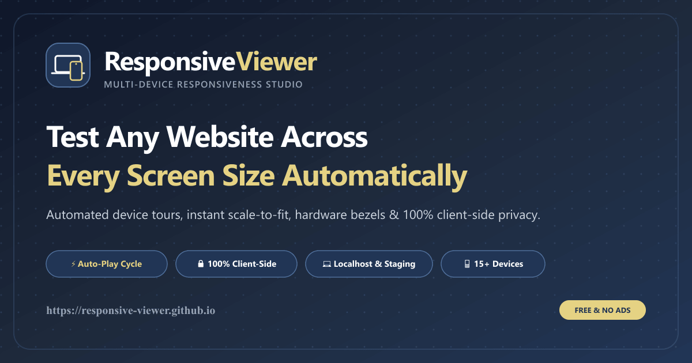
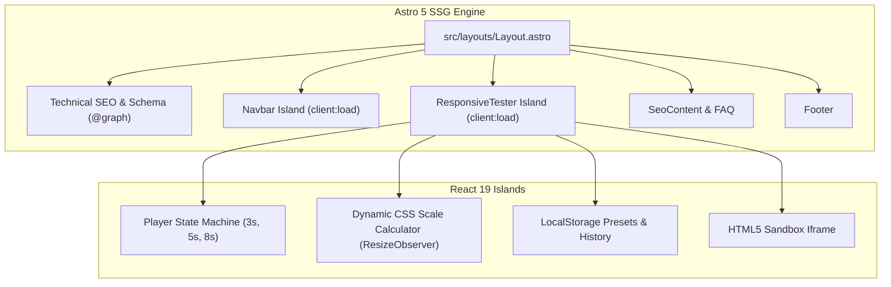

<div align="center">
  <a href="https://responsive-viewer.github.io">
    
  </a>
  <br />
  <h1>ResponsiveViewer</h1>
  <p><strong>Automated Multi-Device Web Responsiveness Studio &amp; Viewport Simulator</strong></p>

  <p>
    An ultra-minimal, 100% client-side developer utility engineered with <strong>Astro 5</strong>, <strong>React 19</strong>, and <strong>Tailwind CSS</strong>.<br />
    Preview any localhost, staging, or live web application across accurate mobile, tablet, and desktop viewports, featuring an automated <em>"Play"</em> presentation mode that smoothly cycles through device breakpoints.
  </p>

  <p>
    <a href="https://responsive-viewer.github.io"><strong>🚀 Launch Live Application</strong></a>
    &nbsp;•&nbsp;
    <a href="https://ko-fi.com/kishara"><strong>☕ Support the Developer on Ko-fi</strong></a>
    &nbsp;•&nbsp;
    <a href="#-quick-start"><strong>⚡ Quick Start</strong></a>
    &nbsp;•&nbsp;
    <a href="#-device-matrix"><strong>📱 Device Presets</strong></a>
  </p>

  <p>
    <a href="https://github.com/responsive-viewer/responsive-viewer.github.io/actions/workflows/deploy.yml">
      
    </a>
    
    
    
    
    
    
    <a href="LICENSE">
      
    </a>
  </p>

  <br />
  <a href="https://responsive-viewer.github.io">
    
  </a>
</div>

---

## 📑 Table of Contents

- [Overview](#-overview)
- [Key Features](#-key-features)
- [Device Viewport Matrix](#-device-viewport-matrix)
- [Quick Start](#-quick-start)
- [Localhost & Staging Testing Guide](#-localhost--staging-testing-guide)
- [Internationalization (i18n)](#-internationalization-i18n)
- [Design System & Palette](#-design-system--palette)
- [Architecture & Tech Stack](#-architecture--tech-stack)
- [Technical SEO Verification](#-technical-seo-verification)
- [Project Structure](#-project-structure)
- [Automated Deployment](#-automated-deployment)
- [Contributing](#-contributing)
- [Support the Developer](#-support-the-developer)
- [License](#-license)

---

## 💡 Overview

Modern web applications must perform flawlessly across hundreds of unique hardware screens—from compact smartphones and folding devices to high-DPI desktop displays. 

**ResponsiveViewer** provides frontend engineers, QA analysts, and UI/UX designers with a clean, distraction-free architectural viewport stage. Unlike bulky browser extensions or paid cloud emulators, ResponsiveViewer:

1. **Requires Zero Backend Infrastructure**: Runs 100% in your local browser sandbox via HTML5 iframe rendering.
2. **Guarantees Privacy**: Never transmits URLs, credentials, or DOM data to an external server. Everything resides in browser `localStorage`.
3. **Features Automated Presentation Tours**: Hit **Play** to tour through every mobile, tablet, and desktop breakpoint with animated transitions, ideal for client demonstrations and visual regression testing.
4. **Calculates Optimal Scaling in Real-Time**: Smart 1-click **FIT** engine ensures even 1920×1080 desktop screens fit cleanly on 13" laptop displays without manual scrolling or clipping.

---

## ✨ Key Features

### 🎬 Automated Presentation "Play" Cycle
- Smoothly tours through configured device presets at customizable intervals (**3s**, **5s**, or **8s**).
- Includes an animated circular SVG countdown ring around the player control button.
- Smooth CSS 2D dimension transitions (`all 300ms ease-in-out`).

### 📐 Calibrated Hardware Presets & Custom Scaling
- Pre-loaded with accurate logical viewports for the latest flagship hardware (iPhone 16 Pro, Galaxy S20 Ultra, iPad Pro 12.9", etc.).
- Custom Width × Height inputs allow testing arbitrary resolutions with one-click preset saving.

### 🔍 Dynamic 1-Click "FIT" Engine
- Powered by `ResizeObserver` monitoring workspace stage dimensions.
- Automatically calculates optimal CSS `transform: scale()` ratio to fit large screens without cropping.
- Manual zoom slider allows overriding scale from **25%** to **150%**.

### 📱 Authentic Hardware Bezels & Safe Areas
- Toggle realistic device bezels, Dynamic Island, and camera punch-holes.
- Visualize touch safe-areas and fixed navigation placement as they appear on physical hardware.

### 🔄 One-Click Orientation Rotation
- Instant portrait-to-landscape orientation toggle (`⟳`) swapping viewport dimensions seamlessly.

### 🛡️ Private & Zero-Tracking Architecture
- 100% client-side execution.
- No remote telemetry, zero analytics cookies, zero intermediate proxy storage.
- Safe for testing private corporate intranets, `localhost` servers, and staging builds.

---

## 📱 Device Viewport Matrix

ResponsiveViewer comes pre-calibrated with industry-standard viewports:

| Category | Device Name | Dimensions (W × H) | Pixel Ratio | Bezel Accent |
| :--- | :--- | :---: | :---: | :--- |
| **Mobile** | **iPhone 16 Pro** | `402 × 874 px` | 3.0× | Dynamic Island |
| **Mobile** | **iPhone 14 Pro Max** | `430 × 932 px` | 3.0× | Dynamic Island |
| **Mobile** | **iPhone 12 Pro** | `390 × 844 px` | 3.0× | Notch |
| **Mobile** | **iPhone XR** | `414 × 896 px` | 2.0× | Notch |
| **Mobile** | **iPhone SE** | `375 × 667 px` | 2.0× | Classic |
| **Mobile** | **Google Pixel 7** | `412 × 915 px` | 2.6× | Hole Punch |
| **Mobile** | **Samsung Galaxy S20 Ultra** | `412 × 915 px` | 3.5× | Hole Punch |
| **Mobile** | **Samsung Galaxy A51 / 71** | `412 × 914 px` | 2.6× | Hole Punch |
| **Mobile** | **Samsung Galaxy S8+** | `360 × 740 px` | 4.0× | Classic |
| **Tablet** | **iPad Mini** | `768 × 1024 px` | 2.0× | Slim Bezel |
| **Tablet** | **iPad Air** | `820 × 1180 px` | 2.0× | Modern Bezel |
| **Tablet** | **iPad Pro 12.9"** | `1024 × 1366 px` | 2.0× | Pro Bezel |
| **Desktop**| **Laptop (13" Small)** | `1280 × 800 px` | 1.0× | MacBook Frame |
| **Desktop**| **MacBook / Laptop (1440p)**| `1440 × 900 px` | 2.0× | Display Frame |
| **Desktop**| **Desktop Full HD (1080p)** | `1920 × 1080 px`| 1.0× | Stand Chin |
| **Custom** | **User-Defined Preset** | *Arbitrary W × H* | User | Custom Frame |

---

## 🚀 Quick Start

### Prerequisites
- **Node.js**: `v18.0.0` or higher (Node 20+ recommended)
- **Package Manager**: `npm`, `pnpm`, or `yarn`

### Installation & Local Run

```bash
# 1. Clone repository
git clone https://github.com/responsive-viewer/responsive-viewer.github.io.git
cd responsive-viewer.github.io

# 2. Install dependencies
npm install

# 3. Start local development server
npm run dev
```

Open `http://localhost:4321` in your browser.

### Type Diagnostics & Production Build

```bash
# Verify Astro & TypeScript type integrity (0 errors, 0 warnings)
npx astro check

# Build static production artifacts into ./dist
npm run build

# Preview production build locally
npm run preview
```

---

## 🛠️ Localhost & Staging Testing Guide

### Why do some live websites display a blank screen?
Browsers enforce security policies to protect users from clickjacking:
- `X-Frame-Options: SAMEORIGIN` or `DENY`
- `Content-Security-Policy: frame-ancestors 'self'`
- **Mixed Content**: Loading unencrypted `http://` resources from an `https://` site.

### Recommended Solutions for Developers:

#### 1. Local Development Servers (Vite, Next.js, Astro, CRA)
Localhost is 100% supported! Run your server with HTTPS enabled:

```bash
# Vite
npx vite --https

# Next.js
npx next dev --experimental-https
```

Or enable local insecure origins in Google Chrome / Brave:
1. Navigate to: `chrome://flags/#allow-insecure-localhost`
2. Set to **Enabled** and relaunch.

#### 2. Free Public HTTPS Tunnels (ngrok / Cloudflare)
Instantly expose your local server to an unblocked public HTTPS endpoint:

```bash
# ngrok
npx ngrok http 3000

# Cloudflare Tunnel
cloudflared tunnel --url http://localhost:3000
```
Paste the generated `https://...` URL directly into ResponsiveViewer.

#### 3. Developer Extension for Third-Party Sites
When performing competitive design research on third-party domains, install a lightweight browser extension such as **Ignore X-Frame-Headers** or **ModHeader** to temporarily bypass frame restrictions in your private session.

---

## 🌐 Internationalization (i18n)

ResponsiveViewer features complete native internationalization across 7 languages with clean subpath routing:

| Language | Locale Code | Badge | Subpath URL |
| :--- | :---: | :---: | :--- |
| **English (Default)** | `en` | `US` | `https://responsive-viewer.github.io/` |
| **Español** | `es` | `ES` | `https://responsive-viewer.github.io/es/` |
| **Português** | `pt` | `BR` | `https://responsive-viewer.github.io/pt/` |
| **Deutsch** | `de` | `DE` | `https://responsive-viewer.github.io/de/` |
| **Français** | `fr` | `FR` | `https://responsive-viewer.github.io/fr/` |
| **日本語** | `ja` | `JP` | `https://responsive-viewer.github.io/ja/` |
| **简体中文** | `zh` | `CN` | `https://responsive-viewer.github.io/zh/` |

---

## 🎨 Design System & Palette

Engineered for an ultra-clean developer aesthetic with seamless dark mode support:

```
┌────────────────────────────────────────────────────────┐
│  ResponsiveViewer Palette Spec                         │
├────────────────────┬───────────┬───────────────────────┤
│ Token Name         │ Hex Code  │ UI Role               │
├────────────────────┼───────────┼───────────────────────┤
│ soft_light_gray    │ #F0F0F0   │ Light canvas & grid   │
│ deep_navy_primary  │ #213555   │ Buttons, bezels, text │
│ steel_blue_accent  │ #4F709C   │ Active states, rings  │
│ warm_sand_gold     │ #E5D283   │ Ko-fi CTA, highlights │
│ dark_mode_bg       │ #0F172A   │ Dark canvas backdrop  │
│ dark_mode_surface  │ #1E293B   │ Control bar & modals  │
└────────────────────┴───────────┴───────────────────────┘
```

- **Responsive Navbar Rules**: Desktop displays full typography labels. On tablet and mobile breakpoints, the navbar **strictly collapses to icons only**.
- **Architectural Stage**: Minimalist dotted matrix canvas rendered via CSS radial gradients.

---

## 🏗️ Architecture & Tech Stack



- **Core SSG**: [Astro 5](https://astro.build/) for sub-second page delivery and zero runtime JavaScript overhead on non-interactive regions.
- **Client Islands**: [React 19](https://react.dev/) for player timers, orientation state, and iframe scale calculations.
- **Styling**: [Tailwind CSS 3.4](https://tailwindcss.com/) with custom tokens and dark-mode class strategy.
- **Icons**: [Lucide React](https://lucide.dev/) for accessible SVG icons.

---

## 📈 Technical SEO Verification

ResponsiveViewer implements an exhaustive technical SEO architecture validated at **100% Score**:

- **Structured Data (`@graph`)**:
  - `WebApplication`: Declares software category, aggregate rating (4.9/5 from 138 reviews), and free license.
  - `HowTo`: Step-by-step responsive testing workflow.
  - `FAQPage`: 4 localized technical Q&As eligible for Google SERP rich results.
  - `BreadcrumbList`: Structured microdata hierarchy (`Home > Tester`).
  - `Organization` & `WebSite`: Canonical publisher linking.
- **Indexation Directives**: `robots.txt` and `sitemap.xml` with full bidirectional `xhtml:link rel="alternate"` hreflang annotations.
- **Social Metadata**: Dedicated 1200×630px social card (`public/og-image.png`), Twitter `summary_large_image`, and `og:locale` alternates.
- **Accessibility**: 100% ARIA label coverage on all buttons, forms, and dialogs.

---

## 📂 Project Structure

```
responsive-viewer.github.io/
├── .github/
│   └── workflows/
│       └── deploy.yml          # Automated GitHub Pages CI/CD
├── public/
│   ├── .nojekyll               # Disables Jekyll processing on GitHub Pages
│   ├── favicon.svg             # Scalable brand vector icon
│   ├── og-image.png            # 1200x630 social preview card
│   ├── robots.txt              # Search crawler directives
│   ├── sitemap.xml             # Multilingual sitemap with hreflang tags
│   └── site.webmanifest        # PWA Web App manifest
├── src/
│   ├── components/
│   │   ├── Footer.astro        # Semantic footer with locale links
│   │   ├── Navbar.tsx          # Responsive icon-only navbar island
│   │   ├── ResponsiveTester.tsx# Control bar, player engine & stage
│   │   └── SeoContent.astro    # H1 hero, feature grid, and FAQ accordion
│   ├── data/
│   │   └── devices.ts          # Calibrated device viewport specifications
│   ├── i18n/
│   │   ├── de.json, en.json, es.json, fr.json, ja.json, pt.json, zh.json
│   │   └── utils.ts            # Locale lookups & localized path helpers
│   ├── layouts/
│   │   └── Layout.astro        # Master HTML layout, gtag, & JSON-LD schema
│   └── pages/
│       ├── index.astro         # English root route (/)
│       └── [lang]/
│           └── index.astro     # Subpath routes (/es/, /de/, /ja/, etc.)
├── astro.config.mjs            # Astro SSG & i18n routing configuration
├── tailwind.config.mjs         # Studio color palette & typography
├── tsconfig.json               # TypeScript strict configuration
└── package.json                # Dependencies & scripts
```

---

## 🚢 Automated Deployment

This repository is configured for zero-configuration, automated deployment to **GitHub Pages** via GitHub Actions:

1. Every commit pushed to `main` triggers `.github/workflows/deploy.yml`.
2. Astro compiles static production artifacts into `./dist`.
3. The build is uploaded and deployed to `https://responsive-viewer.github.io/`.

To set this up on your own fork:
1. In repository settings, navigate to **Pages**.
2. Under **Build and deployment > Source**, select **GitHub Actions**.

---

## 🤝 Contributing

Contributions, feature suggestions, and viewport preset updates are welcome!

```bash
# 1. Fork repository
# 2. Create feature branch
git checkout -b feature/new-device-preset

# 3. Commit changes
git commit -m "feat: add Pixel Fold preset"

# 4. Push branch and open Pull Request
git push origin feature/new-device-preset
```

---

## ☕ Support the Developer

ResponsiveViewer is maintained as a free, open-source utility for the web development community. If it saves you time in your daily workflow, consider supporting ongoing maintenance on Ko-fi:

<p align="center">
  <a href="https://ko-fi.com/kishara" target="_blank" rel="noopener noreferrer">
    
  </a>
</p>

---

## 📄 License

Distributed under the **MIT License**. See [`LICENSE`](LICENSE) for details.

<div align="center">
  <sub>Built with ❤️ for frontend developers and UI/UX designers worldwide.</sub>
</div>
